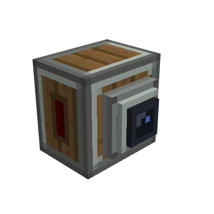
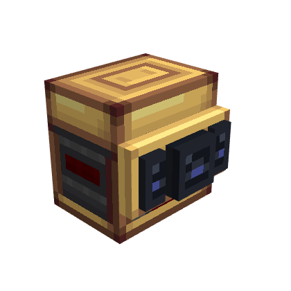

# Computer Craft

CC:Tweaked is an in-game integration for reading sensors, building displays and automation, querying the avionics network, managing FMS waypoints, and responding to Avionics Computer (GPWS) alerts. All code examples and peripheral APIs are collected here for players.

## Connect a computer

Install CC:Tweaked 1.120.0 or newer. Place a computer or wired modem against the block you want to query, or connect it through CC:Tweaked's wired modem network. Sensor, Avionics Computer, and table peripherals are separate from the avionics network.

Find a device by its peripheral type:

```lua
local altimeter = assert(peripheral.find("radar_altimeter"), "Radar Altimeter not found")
local reading = altimeter.getReading()
print(reading.status, reading.value, reading.unit)
```

Use `peripheral.find(type)` for a single device. If several devices share a type, `peripheral.find(type, callback)` can select one by attachment name; `peripheral.getNames()` lists all attached peripherals.

## Peripheral APIs

- [Radar Altimeter](#radar-altimeter-api)
- [Terrain Scanner](#terrain-scanner-api)
- [Advanced Terrain Scanner](#advanced-terrain-scanner-api)
- [Modular Table](#modular-table-api)
- [FMS waypoint API and Navigator](#fms-and-navigator-api)
- [Avionics Computer](#avionics-computer-api)
- [Avionics Network Bridge](#avionics-network-bridge-api)

## Read snapshots and events

Methods return the current snapshot. Events let a program wait for meaningful changes instead of polling every tick. Sensor snapshots use `status`, `unit`, and `gameTime`; `value` is present for valid readings. Treat `unavailable` and `failed` as different states from a numeric zero.

```lua
while true do
  local _, attachment, reading = os.pullEvent("radar_altimeter_reading_changed")
  if reading.status == "valid" and reading.value < 6 then
    print(attachment, "LOW CLEARANCE", reading.value, reading.unit)
  end
end
```

Terrain scan coverage can be partial near unloaded chunks. A partial scan can still report known contacts, but an empty partial scan does not prove the path is clear. See the [Terrain Scanner](#terrain-scanner-api) and [Advanced Terrain Scanner](#advanced-terrain-scanner-api) guides for safe handling.

## Radar Altimeter API


The `radar_altimeter` peripheral returns the measured clearance below the sensor. The independent peripheral works without the avionics network.

### Reading contract

`getReading()` returns `{status, value?, unit, gameTime}`. `status` is `valid`, `unavailable`, or `failed`. `value` is present only for `valid` readings, in `blocks`. `radar_altimeter_reading_changed` supplies the attachment name and updated snapshot; it fires when status or value changes, not for a timestamp-only update.

```lua
local altimeter = assert(peripheral.find("radar_altimeter"), "Altimeter missing")
local reading = altimeter.getReading()
if reading.status == "valid" then
  print(string.format("Clearance: %.1f %s", reading.value, reading.unit))
else
  print("Reading is", reading.status)
end

while true do
  local _, attachment, updated = os.pullEvent("radar_altimeter_reading_changed")
  if updated.status == "valid" and updated.value < 6 then
    print(attachment, "TOO LOW", updated.value)
  end
end
```

### How the reading works

The altimeter casts nine rays downward in a 20° half-angle cone. At least three must hit for a valid sample; the value is the median hit distance from the lower sensor face. It ignores entities and its own host sublevel. It does not load chunks; fewer than three returns gives `unavailable`. Maximum range is 128 blocks by default (`radarAltimeterMaxRange`); scan cadence is shared with other sensors and defaults to 5 ticks (`sensorScanIntervalTicks`).

### Redstone output

The peripheral also exposes `getOutputs()`, `getOutputConfiguration()`, `setOutputRange(channel, min, max)`, and `setLinkFrequencies(channel, first, second)`. Output range maps clearance to signal strength. With no complete frequency pair the signal emits from block faces; a complete pair uses Create Redstone Link.

`getOutputs()` returns a table such as `{altitude = 8}`. `getOutputConfiguration()` returns `{mode, ranges, frequencies}`; the altitude range is `{min, max}`. The only channel name is `altitude`. `setOutputRange("altitude", min, max)` accepts integer distances where `0 <= min < max <= radarAltimeterMaxRange` and returns whether the configuration was accepted. `setLinkFrequencies("altitude", first, second)` accepts frequency tables shaped like `{item = "minecraft:iron_ingot", color = 16711680}`; `color` is optional RGB from 0 to 16777215. Use `{}` for an empty frequency. Both slots must be nonempty to activate Link output.

`setOutputMode("faces"|"link")` remains available for compatibility and returns false for an unknown mode. Routing is automatic from the configured frequency pairs, so this method does not override that selection. Output changes emit `sensor_outputs_changed`; configuration changes emit `sensor_output_configuration_changed` with the updated table.

## Terrain Scanner API



The `terrain_scanner` peripheral reports obstacle contacts in front of the block. It works independently of the avionics network.

### Read a scan

`getScan()` returns `{status, contacts, sampledRays, totalRays, coverage, unit, gameTime}`. `unit` is `blocks`. Every contact includes a 1-based `rayIndex`, `distance`, and relative `directionX`, `directionY`, and `directionZ` (right, up, forward).

```lua
local scanner = assert(peripheral.find("terrain_scanner"), "Terrain Scanner missing")
local function report(scan)
  print(scan.status, scan.sampledRays .. "/" .. scan.totalRays, scan.coverage)
  for _, hit in ipairs(scan.contacts) do
    print("contact", hit.distance, hit.directionX, hit.directionY, hit.directionZ)
  end
end

report(scanner.getScan())
while true do
  local _, attachment, scan = os.pullEvent("terrain_scanner_scan_changed")
  print("Updated:", attachment)
  report(scan)
end
```

Any completed ray makes a sample `valid`, even with partial coverage. If no ray completes, status is `unavailable`; unexpected errors are `failed`. A list with no contacts means no detected obstacle only when coverage is complete. Scans never load chunks, so an unloaded boundary can reduce coverage.

### Scan behavior

The Basic Terrain Scanner uses nine rays at a fixed 90° total aperture. It follows its horizontal facing, including upside-down placement, and ignores entities and its host sublevel. `terrainScannerMaxRange` defaults to 128 blocks; the shared scan interval defaults to 5 ticks.

### Aircraft side

Both scanners report which side of the craft they watch, which the [Avionics Computer](#avionics-computer-api) uses for the scanner's role. `getAircraftSide()` returns `unset`, `front`, `rear`, `left` or `right`. `setAircraftSide(side)` accepts any of these values and returns whether it was applied.

### Redstone output

The peripheral exposes `getOutputs()`, `getOutputConfiguration()`, `setOutputRange(channel, min, max)`, and `setLinkFrequencies(channel, first, second)`. Output increases as a contact gets closer. A complete frequency pair selects Create Redstone Link; otherwise signals emit from block faces.

The configured lower distance bound produces signal strength 15 at or below that distance. The upper bound produces 0 at or above that distance; intermediate readings are scaled across the range. With no usable contact the output is 0.

`getOutputs()` returns the `front` channel strength, such as `{front = 12}`. `getOutputConfiguration()` returns `{mode, ranges, frequencies}`. `setOutputRange("front", min, max)` accepts integer distances within the configured sensor maximum, with `min < max`, and returns a boolean. `setLinkFrequencies("front", first, second)` accepts frequency tables `{item = "minecraft:iron_ingot", color = 16711680}`; RGB `color` is optional and ranges from 0 to 16777215. Use `{}` to clear a frequency slot; both slots must be populated to select Link mode.

`setOutputMode("faces"|"link")` is retained for compatibility; it validates the mode but automatic routing still follows complete frequency pairs. Changes emit `sensor_outputs_changed` and `sensor_output_configuration_changed` with updated snapshots.

For the Advanced scanner, see [its API](#advanced-terrain-scanner-api).

## Advanced Terrain Scanner API



The `terrain_scanner_advanced` peripheral reports contacts through independent `front`, `left`, and `right` channels. It works without the avionics network.

### Read a scan

`getScan()` returns `{status, contacts, sampledRays, totalRays, coverage, unit, gameTime}`. `unit` is `blocks`. Each contact includes a 1-based `rayIndex`, `distance`, and relative `directionX`, `directionY`, and `directionZ` (right, up, forward).

```lua
local scanner = assert(peripheral.find("terrain_scanner_advanced"), "Advanced Terrain Scanner missing")
local scan = scanner.getScan()
print(scan.status, scan.sampledRays .. "/" .. scan.totalRays, scan.coverage)
for _, hit in ipairs(scan.contacts) do
  print("contact", hit.distance, hit.directionX, hit.directionY, hit.directionZ)
end
```

Any completed ray makes a sample `valid`, even with partial coverage. If no ray completes, status is `unavailable`; unexpected errors are `failed`. An empty contact list means no detected obstacle only when coverage is complete. Scans never load chunks, so unloaded terrain can reduce coverage.

### Configure the aperture

The Advanced Scanner distributes approximately 9–81 rays over a 30° to 180° aperture, with 90° as the default. `getConfiguration()` returns `{openingAngle}`. `setOpeningAngle(degrees)` returns true only when it applies a new valid value; otherwise it returns false. The `terrain_scanner_configuration_changed` event supplies the attachment name and updated configuration.

The scanner follows its horizontal facing, including upside-down placement, and ignores entities and its host sublevel. `terrainScannerMaxRange` defaults to 128 blocks; the shared scan interval defaults to 5 ticks.

### Redstone outputs

`getOutputs()` returns the `front`, `left`, and `right` strengths, such as `{front = 12, left = 0, right = 0}`. `getOutputConfiguration()` returns `{mode, ranges, frequencies}`. Output increases as a contact gets closer. The configured lower distance bound produces signal strength 15 at or below that distance; the upper bound produces 0 at or above it. Intermediate readings are scaled across the range, and no usable contact produces 0.

`setOutputRange(channel, min, max)` accepts `front`, `left`, or `right`, integer distances within the configured sensor maximum, and `min < max`; it returns a boolean. `setLinkFrequencies(channel, first, second)` accepts frequency tables such as `{item = "minecraft:iron_ingot", color = 16711680}`. RGB `color` is optional and ranges from 0 to 16777215. Use `{}` to clear a slot.

A complete frequency pair selects Create Redstone Link output. Link mode is global, so provide a complete pair for every channel that should broadcast. Otherwise, signal emits from block faces. `setOutputMode("faces"|"link")` remains for compatibility and validates the value, but routing follows the frequency pairs. Changes emit `sensor_outputs_changed` and `sensor_output_configuration_changed` with updated snapshots.

## Modular Table API


The `modular_table` peripheral reads and configures modules installed in the 3×3 table. Lua grid coordinates start at **1**. Installation and removal remain in-world actions; Lua cannot create a physical module.

### Inspect and configure the panel

Read the grid with `getGridSize()`, `getModules()`, and `getSlot(column, row)`. `canFit(column, row, width, height)` checks a footprint without installing it. Out-of-range coordinates raise a Lua error; a valid footprint that crosses the grid returns false.

`getGridSize()` returns `{columns = 3, rows = 3}`. `getSlot()` returns either `{occupied = false, column = ..., row = ...}` or an occupied module description with `type`, `column`, `row`, `width`, `height`, `channel`, `threshold`, `source`, `alertChannel`, `minimumSeverity`, and `buzzerVolume`. `getOutputs()` returns module descriptions plus `active`, `signal`, and current `severity`. `getPanelStatus()` reports `networkStatus`, `gpwsAvailable`, `muted`, `installedModules`, and `activeModules`.

Choose what a lamp or buzzer indicates with `setIndication(column, row, indication)`: `warning`, `caution`, `inop` or `function:<channel>` for lamps, and `caution` or `warning` for buzzers. `getIndications(moduleType)` lists the indications offered for `lamp` or `buzzer`. The older form `configureAlertModule(column, row, source, channel, minimumSeverity)` still works. `source` is `gpws` or `test`; severity is `advisory`, `caution`, or `warning`. `applyBasicSetup()` resets installed lamps and buzzers to the default GPWS caution indication. The local test signal uses `configureModule(...)` and `setTestSignal(channel, value)`; a module activates when the value reaches its numeric threshold. These test signals are not network sensor readings.

```lua
local panel = assert(peripheral.find("modular_table"), "Table missing")
print(textutils.serialize(panel.getGridSize()))
print(textutils.serialize(panel.getModules()))
panel.applyBasicSetup()
print(textutils.serialize(panel.getOutputs()))

while true do
  local _, attachment, action, module = os.pullEvent("modular_table_changed")
  print(attachment, action, module.type, module.column, module.row)
end
```

Other methods include `getAvailableChannels()`, `getPanelStatus()`, `setBuzzerVolume(column, row, percent)`, `testPanel()`, `setMuted(muted)`, `setLampTestIntensity(column, row, level)`, and `clearLampTestIntensity(column, row)`. Volume accepts 0–100. Test intensity is a temporary visual override and does not cast dynamic world light.

`applyBasicSetup()` returns the number of lamp/buzzer modules configured. `getAvailableChannels()` lists `gpws.any`, `gpws.terrain`, `gpws.pull_up`, `gpws.sink_rate`, `gpws.dont_sink`, `gpws.too_low`, `gpws.bank_angle`, and `gpws.sensor_fail`. The legacy `configureModule(column, row, channel, threshold)` configures an installed lamp for local test values. `setTestSignal(channel, value)` updates that local signal. `configureAlertModule(...)`, `setBuzzerVolume(...)`, and the lamp test methods return booleans; invalid grid coordinates or unsupported modules raise Lua errors.

Events include `modular_table_changed(attachment, action, module)`, `modular_table_signal_changed(attachment, channel, value)`, `modular_table_alert_outputs_changed(attachment, panelStatus, outputs)`, and `modular_table_panel_state_changed(attachment, state, value)`. They report changes confirmed by the server. See [FMS waypoint controls](#fms-and-navigator-api) for waypoint methods and [Avionics Computer](#avionics-computer-api) for alert settings.

### Use the avionics network

`getNetworkSignals()` reads typed channel snapshots published by devices on the connected, complete avionics network. If the traversal is incomplete, do not treat an empty result as proof that no endpoint exists.

## FMS and Navigator API


The FMS is a 2×3 virtual module in the Modular Table. It stores named waypoints with a dimension and integer block coordinates. Lua coordinates for the table grid are 1-based. Fractional coordinates passed to the API are floored, including negative values.

### Manage waypoints from Lua

The table peripheral methods are `getFmsWaypoints(column, row)`, `createWaypoint(column, row, name, x, y, z)`, `updateWaypoint(column, row, id, name, x, y, z)`, `deleteWaypoint(column, row, id)`, `selectWaypoint(column, row, id)`, and `clearWaypointSelection(column, row)`. CRUD and selection methods return true when the requested change is accepted and false when it is not; malformed UUIDs or out-of-range coordinates raise a Lua error. Each waypoint returned is `{id, name, dimension, x, y, z, selected}`. `createWaypoint` returns a boolean, not the new ID; call `getFmsWaypoints` to obtain the UUID.

```lua
local panel = assert(peripheral.find("modular_table"), "Table missing")
local column, row = 1, 1 -- the starting cell of an installed FMS module
for _, waypoint in ipairs(panel.getFmsWaypoints(column, row)) do
  print(waypoint.id, waypoint.name, waypoint.x, waypoint.y, waypoint.z,
    waypoint.selected and "ACTIVE" or "")
end

-- createWaypoint returns true/false; read the list to get the new UUID.
if panel.createWaypoint(column, row, "Home", 0, 64, 0) then
  local waypoints = panel.getFmsWaypoints(column, row)
  local home = waypoints[#waypoints]
  if home then panel.selectWaypoint(column, row, home.id) end
end
```

Waypoint names accept 1–32 characters. New waypoints use the current dimension; editing preserves the waypoint's original dimension. Waypoint data and selected target are stored with the FMS item when the module is removed.

`getFmsSignals(column, row)` returns channel readings keyed by `waypoint_selected` and `distance_to_waypoint`. Each reading has `status`, `unit`, and `gameTime`, plus `value` when valid. `waypoint_selected` is a boolean `VALID` reading. `distance_to_waypoint` is horizontal X/Z distance in blocks and becomes `UNAVAILABLE` without a target or when the target is in another dimension. `modular_table_fms_waypoint_changed(attachment, action, column, row, waypoint)` reports edits; the waypoint table is empty when an event removes a waypoint. `modular_table_fms_signal_changed(attachment, column, row, channel, reading)` reports channel changes. `getNetworkSignals()` can also read typed network channel snapshots; virtual modules include `module_column` and `module_row` to identify their position.

### Bind the Navigator item

The `fms_navigator` item is the FMS Compass. Click **Link compass** on the FMS screen to bind the first one in your inventory to that exact module; the item is not consumed. A compass bound to another FMS shows **Relink to this FMS**, and the click confirms the change. Insert the bound item into an Aeronautics Navigation Table to follow the selected waypoint: unlimited range on the same ship, 256 blocks otherwise. The FMS must be loaded and the waypoint in the same dimension; the lookup does not load chunks. Waypoint Y does not affect the compass direction. FMS channels do not create GPWS alerts.

## Avionics Computer API


The `avionics_computer` peripheral exposes the [Avionics Computer](avionics-computer): its GPWS state, the sensors it found on the network and their roles. It never raycasts or loads chunks. Programs written for the old `gpws` peripheral must switch to `avionics_computer`; profiles, modes, phase overrides and per-channel rules no longer exist.

### Read status, sensors and alerts

| Method | Returns or does |
| --- | --- |
| `getStatus()` | `state` (`normal`, `caution`, `warning`, `inop`, `test`), `alert` (channel), `testing`, `sensitivity`, `flightPhase`, network (`networkStatus`, `networkComplete`, `endpointCount`), `sensorCount`, and `clearance`, `verticalSpeed` and `bankAngle` with status, unit and time |
| `getSensors()` | A list of `{type, role, x, y, z, status, unit, value?, issue?}`, coordinates relative to the computer |
| `getAlerts()` | A table per channel with `state` (`inactive`, `active`, `unavailable`, `inhibited`), `severity`, `gameTime`, and `reason` when INOP |
| `getConfiguration()` | `{sensitivity, inhibited}` |
| `test()` | Runs the self-test; `false` if one is already running |
| `setSensitivity(value)` | `low`, `normal` or `high` |
| `setInhibited(function, inhibited)` | Turns a function off or back on; `sensor_fail` cannot be inhibited |

```lua
local avionics = assert(peripheral.find("avionics_computer"), "Avionics Computer missing")

for _, sensor in ipairs(avionics.getSensors()) do
  print(sensor.role, sensor.status, sensor.value or "-")
end

while true do
  local event, attachment, data = os.pullEvent()
  if event == "avionics_status_changed" then
    print(attachment, "state:", data.state, data.alert)
  end
end
```

Events carry the attachment name and a snapshot: `avionics_alert_changed` (channels whose state or severity changed), `avionics_sensors_changed` (the sensor list, when a role, health or the set of sensors changes; readings alone do not fire it), `avionics_status_changed` and `avionics_configuration_changed`.

### Channels

Channels are `terrain`, `pull_up`, `sink_rate`, `dont_sink`, `too_low`, `bank_angle` and `sensor_fail`. Severity is 0 to 3 (none, advisory, caution, warning). On the network the computer publishes `gpws.<channel>` and `gpws.any`, the highest severity, which the [Modular Table](#modular-table-api) lamps read. The alert envelopes are listed in the [Avionics Computer guide](avionics-computer#functions).

## Avionics Network Bridge API

The **Avionics Network Bridge** is an Experimental, creative-only block. It joins the [avionics network](avionics-network) through a Wire Connector and lets a computer see the network's layout as the `avionics_network_bridge` peripheral. It exposes topology only: for sensor readings with roles and GPWS alerts, use the [Avionics Computer](#avionics-computer-api); each sensor also keeps its own peripheral.

| Method | Returns |
| --- | --- |
| `getNetworkStatus()` | `{status, connected, complete, endpointCount, wireCount}` |
| `getConnectedDevices()` | A list of `{type, x, y, z}`, coordinates relative to the bridge |

`status` is `disconnected`, `connected`, `incomplete` or `limit_exceeded`; `complete` is false for the last two. On an incomplete network the counts are lower bounds and `getConnectedDevices()` returns an empty list, so a partial result is never mistaken for the whole network. The `avionics_network_changed(attachment, status)` event fires when the network changes, with the same table as `getNetworkStatus()`.

```lua
local bridge = assert(peripheral.find("avionics_network_bridge"), "Network Bridge not found")
local network = bridge.getNetworkStatus()
print(network.status, network.endpointCount, network.wireCount)

for _, device in ipairs(bridge.getConnectedDevices()) do
  print(device.type, device.x, device.y, device.z)
end
```
