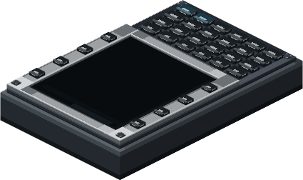

# Modular Table



The Modular Table base has a 3×3 exposed grid and can be mounted on any solid face. The CC:Tweaked peripheral name is `modular_table`; Lua grid coordinates are 1-based. Physical installation and removal are performed in-world, not through Lua. A module's footprint must fit wholly within the grid and overlap no occupied cell. The 2×1 lamp rotates to 1×2 with the scroll wheel; the FMS occupies 2×3.

Lamp modules occupy 1×1 or 2×1 (rotatable to 1×2) and use emissive glass in the module model. This is a visual effect, not dynamic light cast into the world. A buzzer occupies 1×1; its configured volume also scales its sound range proportionally, up to 16 blocks at 100%. Sound is spatial at the module position, including when the table is on a moving Sable sublevel.

Right-click an empty cell with an empty main hand to open the table panel; right-click a lamp or buzzer for its settings. Hold a module and right-click the exposed face to preview and install it. Use the Create Wrench to remove a module. Off-hand actions do not install or remove modules.

Core methods include `getGridSize()`, `getModules()`, `getSlot(column, row)`, `canFit(column, row, width, height)`, `getOutputs()`, `getAvailableChannels()`, and `getPanelStatus()`. `canFit` only queries; out-of-range coordinates raise a Lua error, while a valid footprint crossing the grid returns false.

Additional methods are `configureModule(column, row, channel, threshold)`, `configureAlertModule(column, row, source, channel, minimumSeverity)`, `setBuzzerVolume(column, row, percent)`, `applyBasicSetup()`, `testPanel()`, `setMuted(muted)`, `setTestSignal(channel, value)`, `setLampTestIntensity(column, row, level)`, and `clearLampTestIntensity(column, row)`. The test signal activates a module when its value reaches the configured numeric threshold; it is local to this table and is not a sensor/network reading.

Modules can be configured with `configureAlertModule(column, row, source, channel, minimumSeverity)`. `source` is `gpws` or `test`; severity is `advisory`, `caution`, or `warning`. `applyBasicSetup()` assigns all lamps and buzzers to `gpws.any` at Caution. For local compatibility signals, use `configureModule(...)` and `setTestSignal(channel, value)`. `setBuzzerVolume(..., percent)` accepts 0–100, `setMuted(boolean)` controls buzzers, and `testPanel()` runs a three-second test. Lamp preview overrides are temporary and do not create dynamic world light.

```lua
local panel = assert(peripheral.find("modular_table"), "Table not found")
print(textutils.serialize(panel.getGridSize()))
panel.applyBasicSetup()
print(textutils.serialize(panel.getOutputs()))

while true do
  local _, attachment, action, module = os.pullEvent("modular_table_changed")
  print(attachment, action, module.type, module.column, module.row)
end
```

Events include `modular_table_changed`, `modular_table_signal_changed`, `modular_table_alert_outputs_changed`, and `modular_table_panel_state_changed`. They represent server-confirmed changes. See [FMS methods](fms) for waypoint access and [GPWS](gpws) for alert configuration. The network bridge, not the table, provides aggregate topology status.
