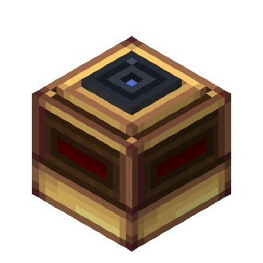
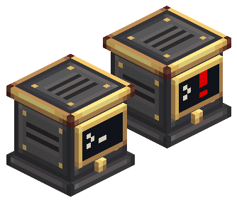
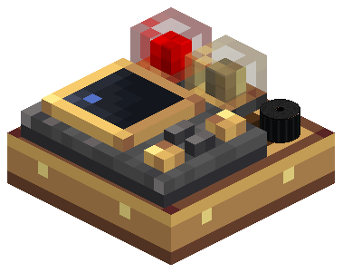
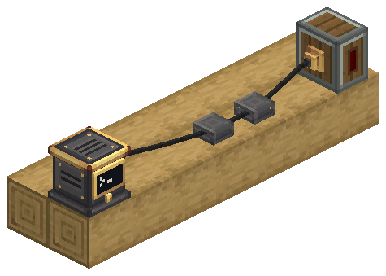
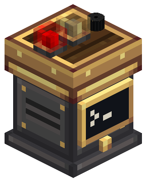

# Fly by Instruments

[Página no CurseForge](https://www.curseforge.com/minecraft/mc-mods/aeronautics-fly-by-instruments)

Fly by Instruments adiciona blocos aviônicos para naves do Create Aeronautics. Radar Altimeters e Terrain Scanners medem o mundo ao redor da aeronave e disponibilizam leituras por redstone e CC:Tweaked. O conjunto experimental acrescenta o Avionics Computer com seu GPWS, a Modular Table do cockpit com lâmpadas, buzzers e FMS, e o Avionics Wire que liga tudo.

**Documentação referente à versão 0.2.0 de Fly by Instruments** · Minecraft 1.21.1 · NeoForge.

## Documentação

- [Instalação e uso](player/)
- [Sensors](player/sensors): Radar Altimeter, Terrain Scanner e Advanced Terrain Scanner
- [Avionics Computer e GPWS](player/avionics-computer) (Experimental)
- [Modular Table](player/modular-table): lâmpadas, buzzer e FMS (Experimental)
- [Avionics Wire](player/avionics-network): conectores, suportes e Wiring View (Experimental)
- [Computer Craft](player/computer-craft)

Os sensores são os blocos lançados com receitas. As páginas Experimental cobrem o conjunto aviônico adicionado na 0.2.0. Computer Craft reúne todas as instruções de CC:Tweaked e Lua em uma só página.

| | |
| --- | --- |
|  |  |
|  |  |

## Changelog

[Consultar notas de versão](./changelog)

Os sensores são os blocos lançados com receitas. Os demais blocos aviônicos estão marcados como Experimental e não têm receitas na versão atual; o comportamento pode mudar.
