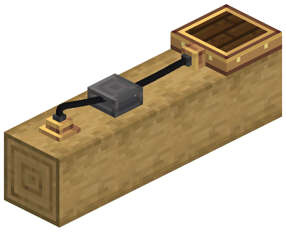

# Avionics Wire

::: warning Experimental
O Avionics Wire (no jogo em português, Fio Aviônico) é conteúdo Experimental adicionado na 0.2.0. As peças podem ser fabricadas, mas o comportamento pode mudar.
:::

O Avionics Wire é a rede aviônica: leva dados entre os instrumentos, os sensores, o [Avionics Computer](avionics-computer) e a [Modular Table](modular-table). É um fio de verdade, que pende entre conectores e passa por suportes. Não é bloco, então não ocupa espaço.

A rede só leva dados: nada de energia nem redstone. Cada instrumento continua com a própria saída de redstone e o próprio peripheral do Computer Craft.

## Peças

O fio usa três itens (no jogo em português: Conector de Fio, Suporte de Fio e Fio Aviônico):

| Item | O que é |
| --- | --- |
| **Wire Connector** | Um soquete de latão montado numa face. Liga ao fio o bloco em que está. |
| **Wire Support** | Uma braçadeira de ferro industrial. O fio passa por dentro, no chão, na parede ou no teto. Não leva dados. |
| **Avionics Wire** | O carretel com que você passa o fio. Um item faz 8 blocos de fio. |

## Passar um fio

1. Monte um **Wire Connector** numa face de cada dispositivo que quer ligar (sensor, Avionics Computer, Modular Table), ou em qualquer bloco para fazer uma junção. No Radar Altimeter e nos Terrain Scanners ele encaixa num soquete do corpo.
2. Monte **Wire Supports** em qualquer face pelo caminho.
3. Segure o **Avionics Wire** e use no primeiro conector, depois em cada suporte na ordem, depois em outro conector.
   - Um fio fantasma segue a mira com o formato real. Fica branco quando o próximo clique é aceito e vermelho, com o motivo, quando não é. O comprimento e o custo aparecem embaixo da mira.
   - Agache e use no ar para desfazer o último ponto. Com só o início, cancela. Usar de novo o conector inicial também cancela.
4. No criativo não custa nada.

| Regra | Padrão |
| --- | --- |
| Maior vão entre dois pontos | 24 blocos |
| Pontos por fio, pontas incluídas | 32 |
| Blocos de fio por item | 8 (arredondado para cima por fio) |
| Fios por conector | 4 |
| Fios por suporte | 3, lado a lado |

Fios podem atravessar blocos. Todos os pontos de um fio precisam estar na mesma estrutura: o mundo ou uma nave do Aeronautics. Um fio entre uma nave e o chão não é possível.

## Onde os conectores ficam

- Na **borda de uma Modular Table**, o conector perde a flange externa e fica centrado na borda de 4 pixels.
- Uma haste curta entra no bloco atrás do conector, então ele também encosta em dispositivos com laterais recuadas, como o Avionics Computer.

## Remover um fio

- Quebrar um conector ou um suporte remove todos os fios que passam por ele e devolve os itens do fio (fora do criativo).
- Na Wiring View, agache e use a **Wrench** do Create num fio para cortar só aquele fio. Os itens voltam para o inventário.
- Os Engineer's Goggles num conector ou suporte mostram quantos fios ele segura e o comprimento deles.

## Wiring View

Aperte **V** para ligar e desligar a Wiring View. Dá para trocar a tecla em Controles → Aeronautics: Fly by Instruments. O mundo escurece, e todo fio, conector e suporte num raio de 48 blocos aparece através dos blocos. Dispositivos com conector ganham um marcador. Mire num fio para ver o comprimento e a rede dele.

| Cor do fio | Rede |
| --- | --- |
| Latão | Completa, com dois ou mais dispositivos |
| Cinza | Completa mas sem com quem conversar, ou desconectada |
| Vermelho | Chega a uma área descarregada, ou é grande demais |
| Latão apagado | Estado ainda não recebido |
| Branco | O fio sob a mira |

`V` também é a tecla padrão do Simple Voice Chat. Troque uma delas se usar os dois.

## Dispositivos acoplados

Uma **Modular Table** montada diretamente em qualquer face de um **Avionics Computer**, em cima ou numa lateral, fica acoplada a ele. Os dois contam como um dispositivo só na rede, sem fio entre eles. Veja [Modular Table](modular-table#acoplar-uma-mesa-ao-computador).

## Limites

- A rede nunca carrega chunks. Se chega a uma área descarregada, fica **incompleta**, e os dispositivos além dela não contam.
- Uma rede visita no máximo 4096 blocos (`maxAvionicsNetworkBlocks`). Uma maior informa **rede grande demais**.

| Opção do servidor | Padrão | O que faz |
| --- | --- | --- |
| `maxAvionicsNetworkBlocks` | 4096 | Máximo de conectores e dispositivos visitados por uma rede |
| `wireMaxSpan` | 24 | Maior vão de fio entre dois pontos, em blocos |
| `wireMaxPoints` | 32 | Pontos por fio, pontas incluídas |
| `wireBlocksPerItem` | 8 | Blocos de fio que um item de Avionics Wire faz |
