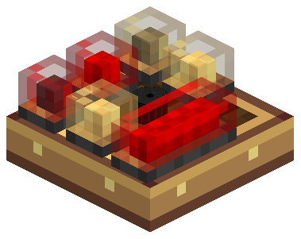

# Modular Table

::: warning Experimental
A Modular Table e seus módulos são conteúdo Experimental. Podem ser fabricados, mas o comportamento pode mudar.
:::

A Modular Table (no jogo em português, Base da Mesa Modular) é o painel do cockpit. É uma placa fina de latão e madeira com um grid de 3 × 3 células. Nas células você instala **módulos**: lâmpadas de alerta, um buzzer e o Flight Management System (FMS). As lâmpadas e o buzzer mostram os alertas do [Avionics Computer](avionics-computer).

## Colocar mesas

- Monte a **Modular Table Base** em qualquer face sólida: chão, parede ou teto.
- **Mesas lado a lado**, no mesmo plano e montadas na mesma face, se unem num **painel**. A moldura de latão contorna o grupo todo. Um módulo pode passar de uma mesa para a seguinte, por exemplo uma lâmpada longa sobre duas mesas ou um FMS sobre quatro. Mesas que só se tocam no canto não se unem. Um painel aceita até 256 mesas.
- Ligue o painel à [rede aviônica](avionics-network) com um Wire Connector em qualquer uma das mesas. Uma ligação alimenta todas as mesas do painel. Na borda de uma mesa, o Wire Connector perde a flange externa e encaixa na borda.

### Acoplar uma mesa ao computador

Monte uma mesa **diretamente em qualquer face de um Avionics Computer**, em cima ou numa lateral. A mesa fica acoplada: entra na rede do computador sem fio, e as lâmpadas já mostram os alertas dele.

## Módulos

| Módulo | Tamanho | O que faz |
| --- | --- | --- |
| **Lamp Module (1×1)** | 1 célula | Luz de alerta, vermelha ou âmbar |
| **Lamp Module (2×1)** | 2 células | Luz de alerta longa. Role o scroll mirando na mesa para deixá-la em pé (1×2) |
| **Buzzer Module (1×1)** | 1 célula | Apita nos alertas, a partir da posição do módulo no mundo |
| **FMS (2×3)** | 2 × 3 células | Flight Management System: waypoints e bússola de proa |

### Instalar e remover

1. Segure um módulo na mão principal e mire na mesa. O grid mostra o espaço do módulo: verde se cabe, vermelho se colide ou passa da borda.
2. Clique com o botão direito para instalar. No sobrevivência gasta um item; no criativo ele fica.
3. Clique com o botão direito num módulo instalado usando a **Wrench** do Create para removê-lo. O item volta para o inventário, ou cai se ele estiver cheio.

Quebrar a mesa derruba os módulos dela. Agache e clique com a Wrench na mesa para recolhê-la pela ação do próprio Create.

## Lâmpadas e buzzers

Cada lâmpada ou buzzer escolhe **o que indica**, numa lista curta, como os anunciadores de um cockpit real. A cor da lente vem da indicação e continua visível com a lâmpada apagada.

| Indicação | Acende quando | Cor |
| --- | --- | --- |
| Alerta GPWS | Qualquer função do Avionics Computer está em Alerta | Vermelho |
| Atenção GPWS (padrão) | Qualquer função está em Atenção ou Alerta | Âmbar |
| GPWS INOP | O computador está INOP, ou nenhum computador responde numa rede completa | Âmbar |
| Função específica | Uma função: Terrain ahead, Pull up, Sink rate, Don't sink, Too low ou Bank angle | Âmbar, vermelho em Alerta |

O buzzer toca em **Atenção GPWS** (padrão, todo alerta) ou em **Alerta GPWS** (só os vermelhos), no volume que você escolher. O bip é rápido em Alerta e lento em Atenção. A 100% dá para ouvir a até 16 blocos; volumes menores alcançam menos.

| Com a mão principal vazia | Resultado |
| --- | --- |
| Clique direito numa lâmpada apagada ou num buzzer em silêncio | Abre a configuração do módulo. As mudanças aplicam na hora |
| Clique direito numa lâmpada acesa ou num buzzer tocando | Reconhece o alerta e silencia os buzzers do painel, como um Master Warning. Um alerta novo ou pior volta a tocar |
| Agachar + clique direito numa lâmpada acesa ou num buzzer tocando | Abre a configuração do módulo |
| Clique direito numa célula vazia | Abre o painel: estado do computador, módulos, lâmpadas acesas, **Testar painel** e **Silenciar** |

Com a **Wrench** do Create, role o scroll sobre uma lâmpada para alternar entre Alerta GPWS e Atenção GPWS, ou sobre um buzzer para mudar o volume de 10 em 10%. Um rótulo ao lado da mira mostra a configuração atual e a próxima.

A mesa também emite um pouco de luz de bloco a partir da lâmpada acesa mais forte (opção do servidor `lampLightLevel`, padrão 5, `0` desliga).

## Flight Management System

Clique com o botão direito em qualquer célula do FMS para abri-lo. Tudo fica num só painel e cada clique vale na hora.

- **Destino:** o topo do painel mostra **Direto para** o waypoint ativo, com distância, rumo e posição. Um waypoint em outra dimensão mostra "Outra dimensão" no lugar da distância. Sem destino, o painel avisa e a tela do FMS na mesa fica escura.
- **Waypoints:** a lista mostra cada waypoint com sua distância. Clique num deles para voar direto até ele; clique de novo no ativo para limpar o destino. Clique com o botão direito num waypoint para editá-lo. A lista rola a partir de sete waypoints.
- **Novo waypoint:** abre o editor já preenchido com a sua posição e com o nome pronto para digitar. **Usar minha posição** preenche de novo onde você está. As coordenadas são blocos inteiros; decimais arredondam para baixo. Waypoints novos usam a dimensão atual. Para apagar um waypoint, abra-o e clique em **Excluir** e depois em **Confirmar exclusão**.
- **Limpar destino** remove o waypoint ativo.

Com um destino definido, a tela do FMS na mesa mostra uma bússola que gira com a proa da aeronave e marca o waypoint.

### Bússola FMS

A seção **Bússola FMS** mostra a primeira Bússola FMS do inventário: fora do inventário, não vinculada, vinculada aqui ou vinculada a outro FMS. Clique em **Vincular bússola** para vinculá-la a este módulo exato; o item não é gasto. Se ela já aponta para outro FMS, o botão vira **Vincular a este FMS** e o clique confirma a troca.

Coloque a bússola vinculada numa **Navigation Table** do Aeronautics e ela aponta para o waypoint ativo. Na mesma nave do FMS o alcance é ilimitado; fora dela, a mesa e o FMS precisam estar a até 256 blocos. O FMS precisa estar carregado e o waypoint na mesma dimensão.

Os waypoints, o destino selecionado e a identidade do módulo acompanham o item do FMS quando você o remove.
