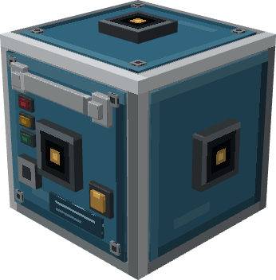

# GPWS Computer



O GPWS Computer consome snapshots de Radar Altimeters e Terrain Scanners na Avionics Cable Network. Ele não faz raycasts nem carrega chunks. Leituras com mais de dois intervalos de sensor ficam obsoletas. Computador e sensores precisam estar na mesma rede completa.

## Perfis e operação

O perfil Basic é o padrão. Com uma rede completa e Radar Altimeter válido, arma automaticamente; jogadores podem ativar/desativar e escolher sensibilidade Low, Normal ou High. Terrain Scanners são opcionais no Basic. O perfil Advanced começa em Standby e exige acionamento explícito; thresholds, histerese, confirmações e substituições manuais de fase são configurados por CC:Tweaked. O modo Test simula Warning em todos os canais sem alterar leituras dos sensores. Ao recarregar o mundo, o modo volta para Standby.

As fases automáticas são `GROUND`, `TAKEOFF`, `CLIMB`, `CRUISE`, `DESCENT`, `APPROACH` e `UNKNOWN`. Mudanças comuns exigem duas amostras. Ground exige AGL ≤1,5 bloco e velocidade vertical ≤0,5 bloco/s por 20 ticks. Os alertas de risco ficam quietos enquanto solo é confirmado. Sensibilidade High desloca os limites para avisos mais cedo; Low faz o inverso.

## Canais padrão

Estes são valores de gameplay, não limites aeronáuticos reais. Alertas regulares usam histerese de 10% e duas amostras para ativar/limpar; `PULL_UP` ativa na primeira amostra qualificadora.

| Canal | Comportamento padrão |
| --- | --- |
| `TERRAIN` | Caution quando contato conhecido está a até 32 blocos, ou 8 em Approach. Scanner ausente ou cobertura insuficiente sem contato conhecido resulta em Unavailable. |
| `PULL_UP` | Warning imediato para contato conhecido a até 8 blocos no cone frontal central de 45°, ou tempo estimado até o solo ≤2 s durante descida. |
| `SINK_RATE` | Caution com descida ≥6 blocos/s; Warning a ≥12. |
| `DONT_SINK` | Warning após perda ≥4 blocos de AGL recente em Takeoff/Climb, numa janela de 5 s. |
| `TOO_LOW` | Fora de Ground, Caution com AGL ≤8 e Warning ≤3; em Approach, limites ≤3 e ≤1. |
| `BANK_ANGLE` | Fora de Ground, Caution a ≥30° e Warning a ≥45°. |
| `SENSOR_FAIL` | Caution se a rede estiver incompleta/desconectada, faltar o altímetro obrigatório ou uma fonte instalada relevante falhar/ficar obsoleta. |

Canais de risco são suprimidos em Ground, Standby e Off. Standby ainda informa `SENSOR_FAIL`; Off suprime todos os alertas. Um contato em cobertura parcial pode sustentar um alerta, mas ausência de contato com cobertura parcial não comprova rota livre.

## CC:Tweaked

Tipo do peripheral: `gpws`. `getStatus()` retorna modo, perfil, fase, estado da rede, contagem de endpoints, clearance, velocidade vertical e bank com status/unidade/tempo. `getAlerts()` retorna estado e severidade por canal. `getConfiguration()` informa regras efetivas. Métodos: `setMode(mode)`, `setProfile(profile)`, `setSensitivity(value)`, `setAlertConfiguration(channel, phase, config)` e `setPhaseOverride(phaseOrAuto)`.

```lua
local gpws = assert(peripheral.find("gpws"), "GPWS Computer não encontrado")
gpws.setProfile("basic")
gpws.setSensitivity("normal")
print(textutils.serialize(gpws.getStatus()))

while true do
  local _, attachment, alert = os.pullEvent("gpws_alert_changed")
  print(attachment, textutils.serialize(alert))
end
```

No perfil Advanced, `setAlertConfiguration` aceita `cautionThreshold`, `warningThreshold`, `secondaryWarningThreshold`, `hysteresisPercent` (0–90), `confirmationSamples` (1–20) e `inhibited`. Thresholds finitos aceitam 0–4096; zero desativa aquele nível. O significado depende do canal: distância para TERRAIN, distância/tempo até o solo para PULL_UP, velocidade de descida para SINK_RATE, perda de AGL para DONT_SINK, AGL para TOO_LOW e graus para BANK_ANGLE. Escritas inválidas e alterações de configuração no Basic retornam false sem modificar estado.

Eventos: `gpws_alert_changed`, `gpws_flight_phase_changed`, `gpws_mode_changed` e `gpws_configuration_changed`; cada um fornece nome da attachment e snapshot. São emitidos quando o estado relevante muda.
